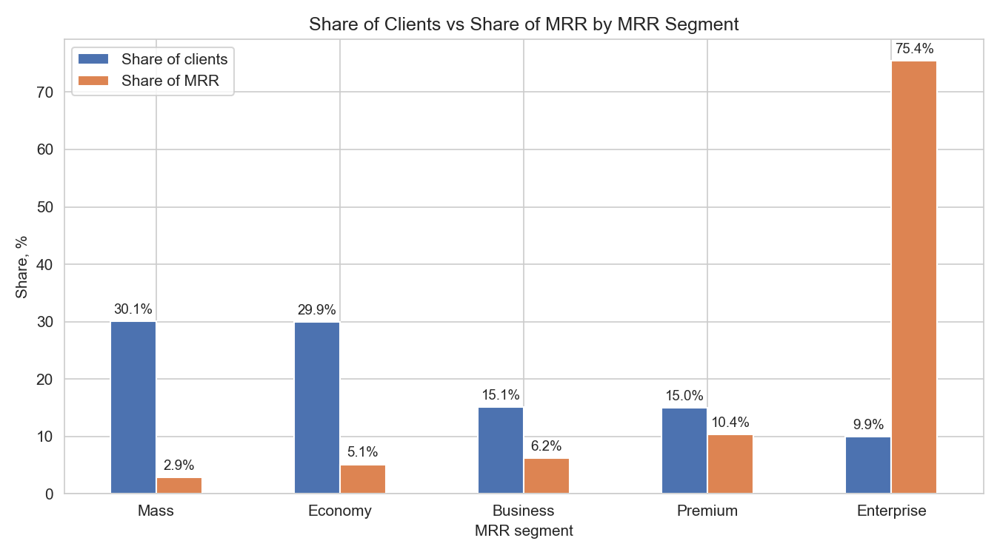
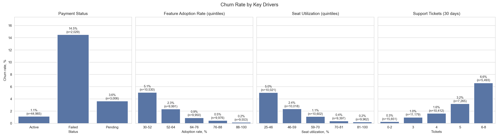
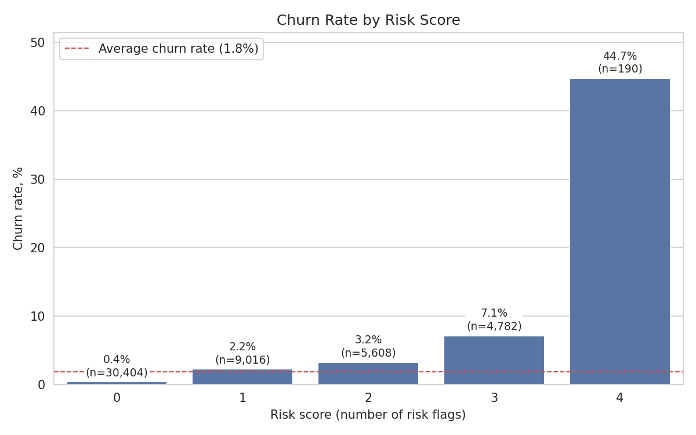
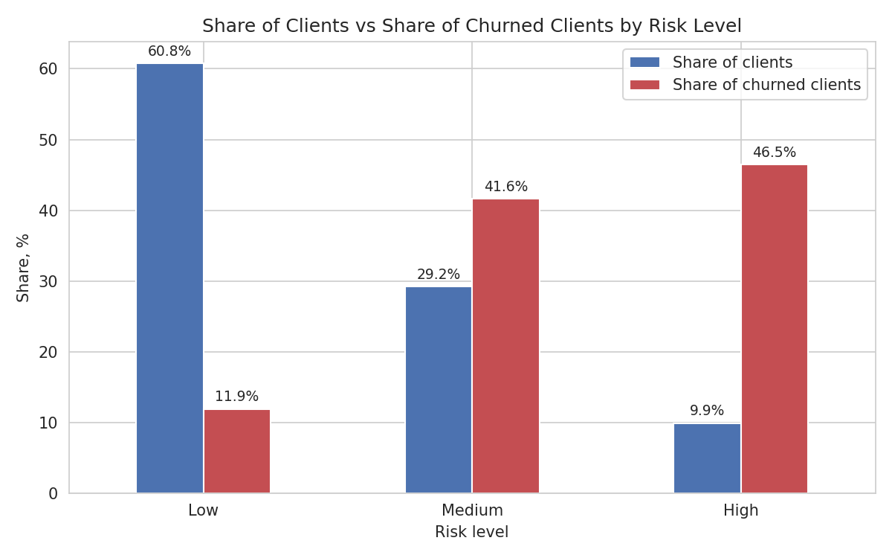

# Анализ оттока клиентов B2B SaaS

Какие клиенты уходят, почему и кому в первую очередь должна позвонить команда customer success? Разведочный анализ, скоринг риска на правилах и приоритетный список для удержания на датасете B2B SaaS (Python + SQL).

🇬🇧 [English version](README.md)

## Описание

SaaS-компания теряет около 2% клиентов, но потери неравноценны. Проект отвечает на три вопроса:

1. Какие сегменты клиентов уходят чаще и сколько выручки (MRR) это стоит?
2. Какие сигналы связаны с оттоком: статус оплаты, adoption функций, загрузка мест, обращения в поддержку?
3. Каких действующих клиентов нужно контактировать первыми, исходя из риска и MRR?

Скоринг риска строится на простых понятных правилах (без машинного обучения) и проверяется на фактическом оттоке.

## Основные результаты

**1. Десять процентов клиентов приносят три четверти выручки.** Сегмент Enterprise это 9,9% клиентов и 75,4% MRR, поэтому потеря одного Enterprise-клиента стоит как потеря десятков клиентов Mass. Logo churn равен 1,8% (916 из 50 000 клиентов), а MRR churn ниже, 1,2% ($396 040 из примерно $33,3 млн месячного MRR), потому что ушедшие клиенты в среднем меньше.



**2. Проблемы с оплатой, слабое использование продукта и много тикетов идут вместе с оттоком.**

- Неудачный платёж: отток 14,5% против 1,1% у клиентов со статусом оплаты Active.
- Adoption функций: отток 5,1% в нижней пятой части клиентов против 0,2% в верхней.
- Загрузка мест: отток 5,0% в нижней пятой части против 0,2% в верхней.
- Обращения в поддержку: отток 6,6% при 6–8 тикетах за 30 дней против 0,3% при 0–2 тикетах.



**3. Простой скоринг риска хорошо разделяет клиентов.** Score это число флагов риска (0–4). Отток растёт с каждым флагом, а у клиентов со всеми четырьмя флагами он равен 44,7%, примерно в 24 раза выше среднего.



| Уровень риска | Флагов | Клиентов | Доля клиентов | Ушло | Доля ушедших | Churn rate | К среднему |
|---|---|---:|---:|---:|---:|---:|---:|
| Low | 0 | 30 404 | 60,8% | 109 | 11,9% | 0,4% | 0,2x |
| Medium | 1–2 | 14 624 | 29,2% | 381 | 41,6% | 2,6% | 1,4x |
| High | 3–4 | 4 972 | 9,9% | 426 | 46,5% | 8,6% | 4,7x |

Группа High это 10% клиентов, но почти половина всех ушедших.



**4. Приоритетный список для команды customer success.** Для каждого действующего клиента ожидаемая потеря = churn rate группы с таким же risk score × MRR. Ранжирование строится по score, а не только по уровню риска: клиент с четырьмя флагами и MRR $1 713 стоит выше клиента с тремя флагами и MRR $8 491.

| Клиент | Сегмент | MRR | Risk score | Ожидаемая потеря | Причины | Рекомендуемое действие |
|---|---|---:|---:|---:|---|---|
| CUST-39138 | Enterprise | $7 799 | 4 | $3 489 | Failed payment; Low feature adoption; Low seat utilization; Many support tickets | Contact the client to resolve the failed payment |
| CUST-44183 | Enterprise | $6 871 | 4 | $3 074 | те же четыре флага | то же действие |
| CUST-22228 | Enterprise | $6 363 | 4 | $2 847 | те же четыре флага | то же действие |

Все клиенты из топ-20 относятся к Enterprise. Для сегментов с меньшей ценой (Mass, Economy, Business) есть отдельный список из 5 самых рискованных клиентов на сегмент: для них подходят автоматические сценарии удержания, а не личные звонки. Полные списки: [`data/priority_list_top20.csv`](data/priority_list_top20.csv) и [`data/priority_list_auto_segments.csv`](data/priority_list_auto_segments.csv).

## Данные

[B2B SaaS Churn Dataset](https://www.kaggle.com/datasets/mpsynthetics/b2b-saas-churn-dataset) с Kaggle: 50 000 клиентов, 18 столбцов (профиль компании, тариф, период оплаты, MRR, даты регистрации и последней активности, статус оплаты, занятые и доступные места, тикеты за 30 дней, adoption функций, churn risk score, признак оттока).

**Примечания к данным**

- Датасет синтетический, поэтому закономерности отражают способ генерации данных, а не поведение реальных клиентов.
- `days_since_last_active` разделяет группы идеально: у ушедших клиентов 30 и более дней, у активных 13 и менее. То есть он определяет отток, поэтому не используется как флаг риска. Встроенный `Churn_Risk_Score` тоже не используется: это готовый скор неизвестного происхождения.
- `tenure_days` считается от даты регистрации до последней даты активности в данных (одинаковой для всех клиентов), поэтому не зависит от того, ушёл клиент или нет.
- Сегменты MRR построены по прайс-листу: Mass $49–79, Economy $99–129, Business $249–299, Premium $399–499 (плюс 79 аккаунтов с $1 500–1 598) и Enterprise от $1 602 до $8 499 (индивидуальные цены).

## Методология

1. **Очистка и аудит** – типы, пропуски, дубли, уникальность ID, даты, проценты, хранящиеся как текст.
2. **Новые признаки** – загрузка мест, дни с последней активности, срок жизни аккаунта, тикеты на место, MRR на место, сегмент MRR.
3. **KPI и сегменты** – logo churn, MRR churn, отток по тарифу, периоду оплаты, статусу оплаты, отрасли, стране, менеджеру, размеру компании и сегменту MRR.
4. **SQL-анализ** – запросы к очищенным данным ([`sql/churn_queries.sql`](sql/churn_queries.sql)).
5. **Risk score** – четыре бинарных флага, score равен их сумме:

   | Флаг | Правило |
   |---|---|
   | Failed payment | `payment_status = Failed` |
   | Low feature adoption | не выше 20-го перцентиля (около 52%) |
   | Low seat utilization | не выше 20-го перцентиля (около 46%) |
   | Many support tickets | 5 и более тикетов за 30 дней |

   Уровни риска: Low = 0 флагов, Medium = 1–2, High = 3–4. Score проверен на фактическом оттоке: показатель растёт с каждым флагом.
6. **Приоритетный список** – ожидаемая потеря для каждого действующего клиента, причины (какие флаги сработали) и рекомендуемое действие.

## Стек

Python · pandas · NumPy · Matplotlib · Seaborn · SQL · Jupyter Notebook · kagglehub

## Структура проекта

```
b2b-saas-churn-analysis/
├── notebooks/
│   ├── 01_cleaning_eda.ipynb                 # очистка, признаки, KPI, EDA
│   └── 02_risk_score_and_priority_list.ipynb # risk score, уровни риска, приоритетные списки
├── sql/
│   └── churn_queries.sql
├── data/
│   ├── priority_list_top20.csv
│   └── priority_list_auto_segments.csv
├── images/
├── requirements.txt
└── README.md
```

Файл `data/clean_data.csv` создаётся первым ноутбуком и в репозитории не хранится.

## Запуск

```bash
git clone https://github.com/dreamkeeperx/b2b-saas-churn-analysis.git
cd b2b-saas-churn-analysis
pip install -r requirements.txt
jupyter notebook notebooks/
```

Сначала запустите `01_cleaning_eda.ipynb`: он скачает датасет через `kagglehub` и создаст `data/clean_data.csv`. Затем запустите `02_risk_score_and_priority_list.ipynb`.

## Ограничения и дальнейшие шаги

- Данные синтетические, поэтому результаты показывают метод, а не реальные бизнес-выводы.
- Пороги флагов и уровни риска подобраны и проверены на одних и тех же данных (in-sample). Более строгая проверка: подобрать пороги на одной половине клиентов и проверить на другой.
- Risk score это ранжирование по правилам, а не прогноз. У ожидаемой потери нет временного горизонта, а эффект рекомендованных действий не измерен.
- Churn rate для score 4 основан на 190 клиентах, поэтому он менее устойчив, чем у остальных групп.
- Возможные шаги: дашборд в Power BI (обзор, сегменты, список риска); когортный анализ по дате регистрации.

## Автор

**Sam** – Junior Data Analyst
